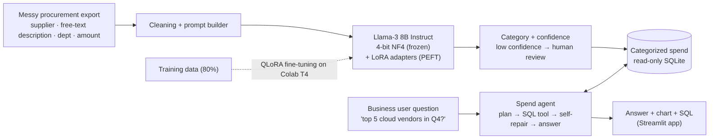
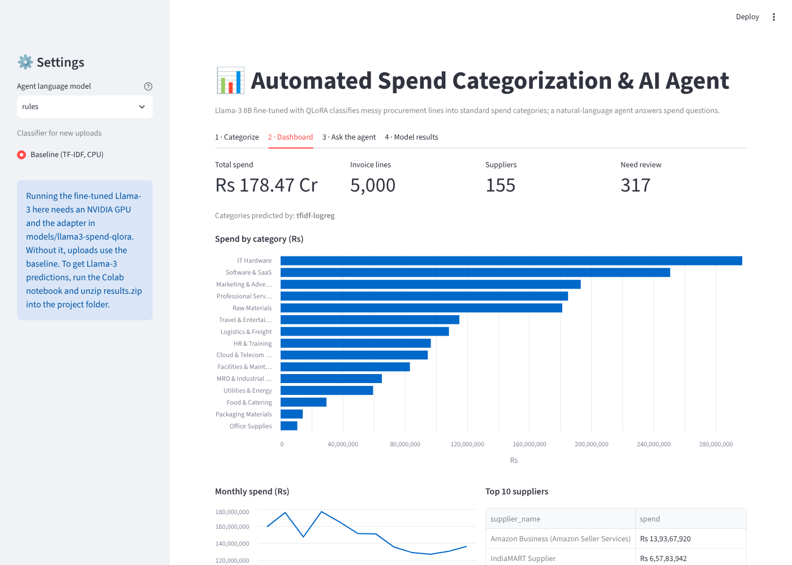
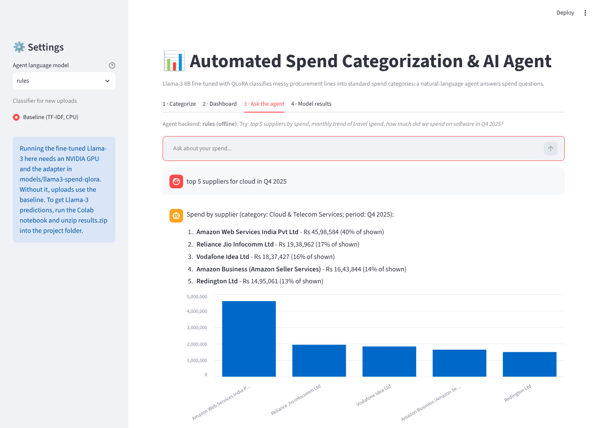

# Automated Spend Categorization & AI Agent

**Python · PyTorch · QLoRA · PEFT · Hugging Face Transformers · Streamlit**

Companies buy thousands of things from hundreds of suppliers. Accounts-payable exports describe those purchases in messy free text, for example `PO-4512 HP 88A TONER x4 /INV2231` or `Being Udemy Business subscr purchased`. Before anyone can analyse spend, every line has to be mapped to a standard spend category.

This project:

1. **Fine-tunes Llama-3 8B Instruct with QLoRA + PEFT** to classify unstructured procurement lines into 15 standardized spend categories, and compares it with a classical TF-IDF baseline and with zero-shot Llama-3.
2. Flags **low-confidence predictions for human review**.
3. Adds a **natural-language agent**, so business users can ask questions like *"top 5 suppliers for cloud in Q4 2025"* and get an answer, a chart and the SQL behind it.
4. Wraps everything in a **Streamlit web app** (categorize → dashboard → chat → model results).



| Dashboard | Agent |
|---|---|
|  |  |

---

## Results (held-out test set, 1,170 rows)

| Model | Accuracy | Macro-F1 | Seen items | **Unseen items** |
|---|---|---|---|---|
| TF-IDF + Logistic Regression (baseline) | 0.902 | 0.902 | 0.974 | 0.860 |
| Llama-3 8B zero-shot | *run notebook* | | | |
| **Llama-3 8B + QLoRA (this project)** | *run notebook* | | | |

*Unseen items* are products that never appear in the training data. They test whether the model generalises the way it has to on real new spend. The notebook writes the LLM numbers to `reports/metrics_llm_qlora.json`, and the app's **Model results** tab shows them automatically. Copy them into this table after training.

---

## Project structure

```
spend-categorization-agent/
├── app.py                      Streamlit web app
├── src/
│   ├── config.py               paths, model name, hyper-parameters, API settings
│   ├── data_generation.py      builds the messy procurement dataset (15 categories, ~150 suppliers)
│   ├── prepare_data.py         cleaning + train/val/test split (with held-out "unseen" items)
│   ├── prompts.py              the classification prompt (shared by training and inference)
│   ├── baseline.py             TF-IDF + Logistic Regression baseline
│   ├── train_qlora.py          QLoRA fine-tuning of Llama-3 8B (4-bit NF4 + LoRA via PEFT)
│   ├── llm_classifier.py       batched inference + confidence score from token probabilities
│   ├── evaluate.py             accuracy / F1 / confusion matrix / error analysis
│   ├── categorize.py           categorize any procurement CSV -> enriched CSV
│   └── agent/
│       ├── spend_db.py         categorized spend -> read-only SQLite + SQL safety guard
│       ├── agent.py            plan -> SQL tool -> self-repair -> answer
│       ├── llm_backends.py     Gemini / Groq / Ollama clients (plain HTTP)
│       └── rules.py            offline question parser (works with no API key)
├── notebooks/train_on_colab.ipynb   end-to-end GPU training notebook
├── data/  taxonomy.json · raw/procurement_raw.csv · processed/*.jsonl · outputs/categorized_spend.csv
├── models/  baseline model + LoRA adapter (after training)
├── reports/  metrics, confusion matrices, loss curve
└── tests/  pytest suite (runs on CPU in ~10 s, uses a tiny random Llama for the LLM code path)
```

---

## How it works

### 1. Data
Real procurement data is confidential, so `src/data_generation.py` builds a realistic synthetic export of **5,000 invoice lines** (FY 2025-26, INR). It reproduces the problems found in real data:

- free-text descriptions, abbreviations (`lic`, `subscr`, `maint`), typos, all-caps, and text cut off by fixed-width ERP fields
- PO, invoice, SKU and GRN codes mixed into the text
- marketplace and "cash purchase" suppliers (Amazon Business, IndiaMART …) that give no hint of the category
- suppliers that sell into several categories (distributors, conglomerates)
- "lazy" entries such as `Payment against PO 4503137155`

The taxonomy has 15 categories, including IT Hardware, Software & SaaS, Cloud & Telecom, Professional Services, Logistics & Freight, Raw Materials and MRO (see `data/taxonomy.json`).

**Split:** 15% of products are held out entirely and go only to the test set ("unseen items"). The rest is split 80/10/10 into train, val and test.

### 2. QLoRA fine-tuning (`src/train_qlora.py`)
- **Base model:** Llama-3 8B Instruct, loaded in **4-bit NF4 with double quantization** through bitsandbytes. The weights take about 5.5 GB of GPU memory and stay frozen.
- **LoRA adapters (PEFT):** rank 16, alpha 32, dropout 0.05, on `q,k,v,o,gate,up,down` projections. That is roughly 42M trainable parameters, about 0.5% of the model.
- **Supervised fine-tuning:** the input is the chat-formatted prompt (category list, supplier, description, department) and the target is the category name. The loss is computed **only on the answer tokens**; prompt tokens are masked with -100.
- **Training setup:** 1 epoch, lr 2e-4 with a cosine schedule, effective batch 16, paged 8-bit AdamW, gradient checkpointing, fp16 on a T4 (bf16 only on Ampere or newer GPUs). Training takes about 35 minutes on a free T4.

### 3. Inference (`src/llm_classifier.py`)
- Generation is greedy and batched with left padding.
- The output is snapped to the closest valid category, so the model can never return an invalid label.
- **Confidence** is the probability of the generated answer, computed from token log-probabilities. Lines with confidence below 0.60 are marked `needs_review`, so a human checks only the uncertain ones.

### 4. Natural-language agent (`src/agent/`)
For each question:
1. **Plan:** the LLM gets the table schema, the category list, a few examples and the recent chat history, and writes one SQLite query.
2. **Act:** the query is checked (single SELECT only, no write keywords) and run on a **read-only** in-memory database.
3. **Repair:** if SQLite raises an error, the error goes back to the LLM once so it can fix its own query.
4. **Answer:** the LLM turns the result table into a short answer with Indian number formatting (lakh/crore). The app also shows a chart and the SQL.

The agent can use any of these backends: **Gemini** or **Groq** (free API keys), **Ollama** (Llama 3 running locally, no key), or **rules**, an offline parser that needs no LLM. If the LLM backend fails, the agent falls back to rules automatically, so it always answers.

---

## Running it

### A. On your laptop (Windows, CPU is fine)
1. Install **Python 3.11 or 3.12** from python.org and tick **"Add python.exe to PATH"**.
2. Double-click **`setup_windows.bat`**. It creates `.venv`, installs the requirements, trains the baseline and runs the tests.
3. Double-click **`run_app.bat`**. The app opens at http://localhost:8501.

Or run it manually:
```bash
python -m venv .venv
.venv\Scripts\activate            # macOS/Linux: source .venv/bin/activate
pip install -r requirements.txt
python -m src.baseline            # train + evaluate the baseline
python -m src.categorize --model baseline
streamlit run app.py
python -m pytest -q               # tests
python -m src.agent.agent "top 5 suppliers by spend"   # agent in the terminal
```

### B. Fine-tune Llama-3 on a free GPU
Llama-3 8B needs a GPU with at least ~12 GB of memory, so training runs in the cloud. Two options:

**Kaggle (runs in the background; recommended):**
1. On kaggle.com, verify your phone number (Settings → Phone verification), then under **API** click **Create New Token** and save `kaggle.json` to `C:\Users\<you>\.kaggle\`.
2. Double-click **`kaggle_train.bat`**. It sends `kaggle_job/train_kaggle.py` to a free Kaggle T4 GPU. The job runs for about an hour, even if your laptop sleeps.
3. Double-click **`kaggle_results.bat`**. When the job has finished, it downloads `results.zip` and unpacks it into the project.

**Google Colab:**
1. Zip the project folder (or clone it from GitHub in the notebook).
2. Open `notebooks/train_on_colab.ipynb` in Colab, choose **Runtime → Change runtime type → T4 GPU**, then **Run all**. Keep the tab open until it finishes.
3. Unzip the downloaded **`results.zip`** into the project folder.

Either way, the results add the LoRA adapter, the metrics and the Llama-3-categorized data, and the app picks them up automatically.

### C. Turn on the LLM agent (optional)
Copy `.env.example` to `.env` and set one of these:
- `AGENT_BACKEND=gemini` and `GEMINI_API_KEY=...` (free key from https://aistudio.google.com/apikey)
- `AGENT_BACKEND=groq` and `GROQ_API_KEY=...` (free key from https://console.groq.com/keys)
- `AGENT_BACKEND=ollama`: install https://ollama.com, then run `ollama pull llama3.1:8b`

You can also choose the backend and paste the key in the app's sidebar.

---

## Limitations & next steps
- The data is synthetic. On a real company export, fine-tune again on a few hundred labelled lines.
- Use a hierarchical taxonomy (for example UNSPSC level 2 or 3) instead of 15 flat categories.
- Use active learning: send `needs_review` rows to a human and add the corrected rows to the next fine-tuning round.
- Serve the adapter with vLLM for high-throughput batch categorization.
